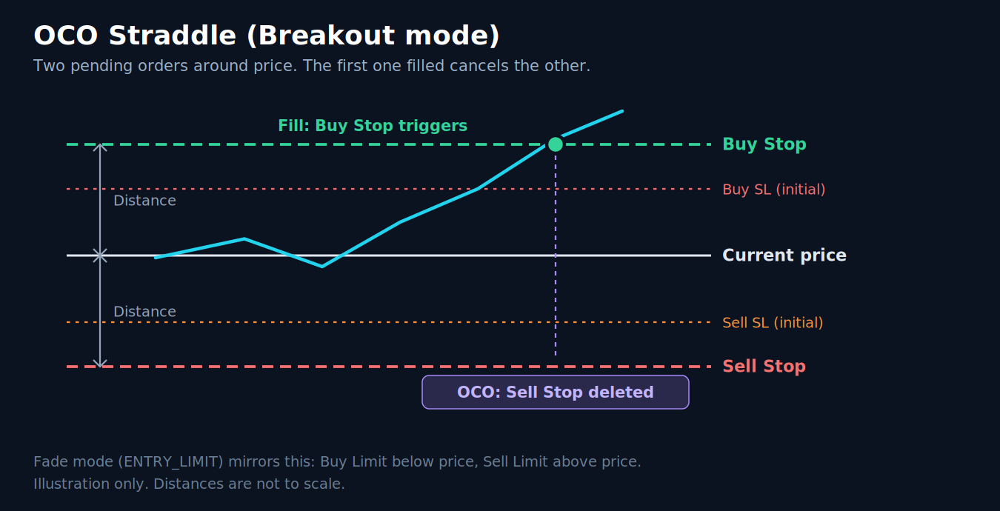
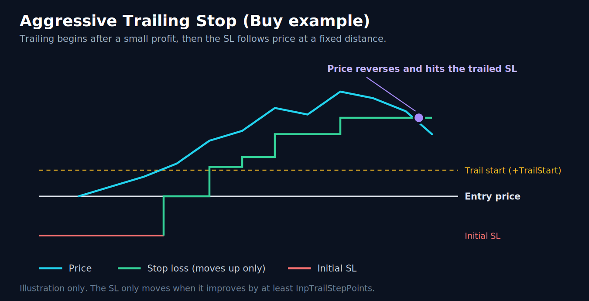
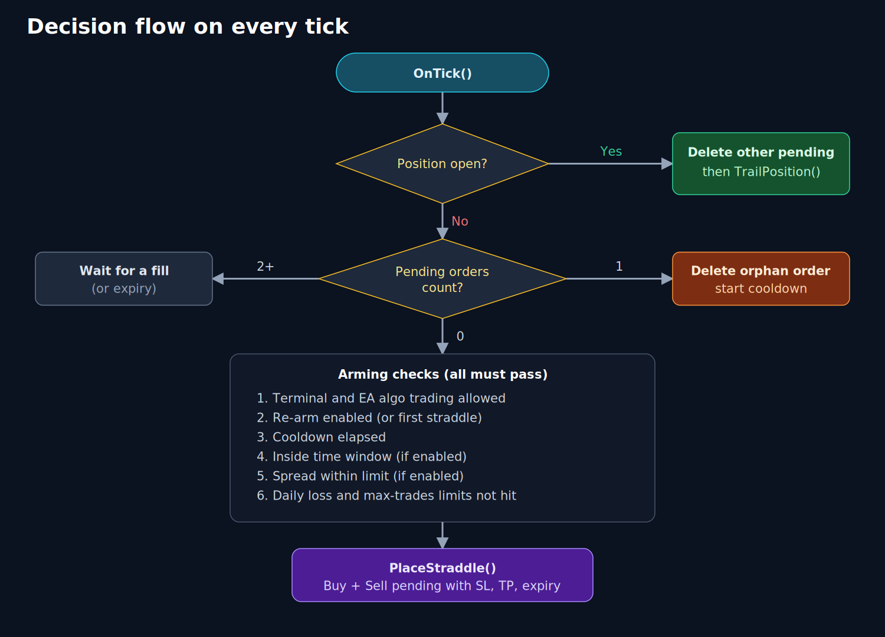
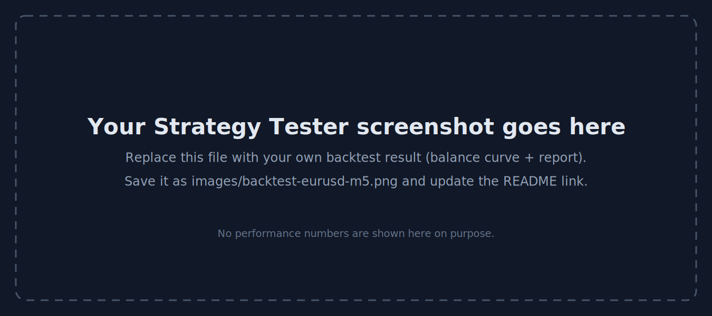

# OCO Straddle Trail EA

An MT5 Expert Advisor that places **two pending orders around the current price**, each with a tight initial stop loss. When one fills, the other is **deleted (OCO: one-cancels-other)** and the open trade is managed by an **aggressive trailing stop**.

> **Test on demo first.** No profit is guaranteed. See the [disclaimer](../../DISCLAIMER.md).

- **File:** [`OCO_Straddle_Trail_EA.mq5`](OCO_Straddle_Trail_EA.mq5)
- **Version:** 1.00
- **Platform:** MetaTrader 5 (MQL5)

## How it works

1. With nothing open and nothing pending, the EA places a **Buy** order above price and a **Sell** order below price, a set distance away (`InpDistancePoints`). Each has a close stop loss (`InpInitialSLPoints`).
2. If neither order fills within `InpExpiryMinutes`, both expire and a new pair is placed after a short cooldown.
3. When one order fills, the EA deletes the other on the next tick.
4. Once the trade is `InpTrailStartPoints` in profit, the stop loss follows price at `InpTrailDistancePoints`, moving only when it improves by at least `InpTrailStepPoints`.
5. When the trade closes, the EA waits `InpCooldownSeconds` and, if `InpRearm` is on, arms a new straddle.

### Entry modes

| Mode | Orders | Idea |
|------|--------|------|
| `ENTRY_STOP` (default) | Buy Stop above, Sell Stop below | **Breakout:** enter when price moves away in either direction |
| `ENTRY_LIMIT` | Buy Limit below, Sell Limit above | **Fade:** enter when price moves against the current level, expecting a reversal |

### Decision flow

## Installation

1. In MT5 press **F4** to open MetaEditor, then **File → Open Data Folder**.
2. Copy `OCO_Straddle_Trail_EA.mq5` into `MQL5/Experts`.
3. Compile it with **F7**, then attach it to a chart.
4. Make sure the **AutoTrading** toolbar button is green and **Allow Algo Trading** is ticked in the EA's *Common* tab.

The chart comment and the **Experts** tab show the current status (for example `ACTIVE`, `WAITING: spread too high`, `PAUSED: daily loss limit reached`).

More detail: [docs/INSTALLATION.md](../../docs/INSTALLATION.md).

## Parameters

> **Points, not pips.** On 5-digit (or 3-digit JPY) brokers, **10 points = 1 pip**. The default distance of 100 points is therefore about 10 pips on EURUSD.

### Entry

| Input | Default | Description |
|-------|---------|-------------|
| `InpEntryKind` | `ENTRY_STOP` | Pending order type: breakout (stop) or fade (limit) |
| `InpDistancePoints` | 100 | Distance of the pending orders from price, in points |
| `InpExpiryMinutes` | 5 | Pending orders expire after this many minutes (0 = no expiry) |

### Exit / Trailing

| Input | Default | Description |
|-------|---------|-------------|
| `InpInitialSLPoints` | 80 | Initial stop loss in points |
| `InpTakeProfitPoints` | 0 | Take profit in points (0 = none, trailing stop only) |
| `InpUseTrailing` | true | Enable the trailing stop |
| `InpTrailStartPoints` | 40 | Start trailing after this much profit (points) |
| `InpTrailDistancePoints` | 40 | Distance of the stop behind price (points) |
| `InpTrailStepPoints` | 5 | Minimum stop improvement per move (points) |

### Risk

| Input | Default | Description |
|-------|---------|-------------|
| `InpFixedLots` | 0.01 | Fixed lot size, used when risk % is 0 |
| `InpRiskPercent` | 0.0 | Risk per trade as % of balance (0 = use fixed lot) |
| `InpMaxDailyLossPercent` | 0.0 | Stop arming for the day at this realized loss % (0 = off) |
| `InpMaxTradesPerDay` | 0 | Maximum trades per day (0 = unlimited) |
| `InpMaxSpreadPoints` | 0 | Do not arm if spread is above this (points, 0 = off) |

### Timing (broker server time)

| Input | Default | Description |
|-------|---------|-------------|
| `InpUseTimeFilter` | false | Only arm new straddles inside the time window |
| `InpStartHour` / `InpStartMinute` | 8 / 0 | Window start |
| `InpEndHour` / `InpEndMinute` | 20 / 0 | Window end (overnight windows are supported) |
| `InpRearm` | true | Arm a new straddle after the previous one finishes |
| `InpCooldownSeconds` | 30 | Wait after a trade closes or orders expire |

### General

| Input | Default | Description |
|-------|---------|-------------|
| `InpMagic` | 20261015 | Magic number identifying this EA's orders |
| `InpSlippagePoints` | 20 | Maximum price deviation in points |
| `InpComment` | `OCOStraddle` | Order comment |

## Built-in safeguards

- Distances and stops are raised automatically to the broker's **stops level / freeze level** (+2 points) if set too low.
- If only one side of the straddle can be placed, the EA **deletes it** so it never leaves a one-sided order.
- If the broker rejects an expiry time, the EA retries once with no expiry. In that case the pending orders stay until one fills.
- The EA reports clear status messages when AutoTrading is off, the spread is too high, or a limit is reached.

## Suggested starting point for testing

These are **starting points for your own testing, not recommended or optimized settings.** Results depend heavily on the symbol, broker spread, commission and execution speed.

| Setting | Conservative test | Default |
|---------|-------------------|---------|
| Symbol / timeframe | A liquid major such as EURUSD, any timeframe (the EA works on ticks) | same |
| Lot size | 0.01, or `InpRiskPercent` of 0.5 to 1.0 | 0.01 |
| `InpMaxSpreadPoints` | A limit slightly above the symbol's normal spread | 0 (off) |
| `InpMaxDailyLossPercent` | 2 to 3 | 0 (off) |
| `InpUseTimeFilter` | On, liquid sessions only | Off |

Prefer an account with low spread and low commission. A short-distance straddle pays the spread on every trade, so costs matter a great deal.

## Known limitations

Understanding these will save you surprises.

1. **OCO is handled by the EA, not by the broker.** The other order is deleted on the next tick after a fill. In a very fast market both orders can fill before that happens. On a *hedging* account you may briefly hold a buy and a sell; on a *netting* account they will offset each other.
2. **Tight stops and spread.** With a distance of 100 points and a stop of 80 points, a few points of spread or slippage is a meaningful share of each trade. Test with realistic spreads and slippage.
3. **Runs on ticks.** Trailing only happens while the EA is running and receiving ticks. It needs a stable connection (a VPS is common practice).
4. **Daily limits are per symbol and magic number.** `InpMaxDailyLossPercent` and `InpMaxTradesPerDay` count only this EA's deals on the chart's symbol. The loss limit uses realized results only.
5. **Risk % sizing uses `InpInitialSLPoints`.** If the broker's minimum stop level forces a wider stop, the real risk is higher than the percentage you entered.
6. **Server time.** The time filter uses broker server time and only affects when new straddles are armed, not trailing of open trades.
7. **State is not saved across restarts.** The "re-arm off" flag resets if the EA is reloaded.
8. **One chart per symbol.** Run one instance per symbol, with a unique magic number if you run several EAs.

## Backtesting

See the [backtesting guide](../../docs/BACKTESTING.md). Use **"Every tick based on real ticks"** for this EA, because pending-order fills and tight trailing stops are very sensitive to tick data quality.

Add your own Strategy Tester screenshots here once you have run them:

## Support

Open an issue in this repository with your MT5 build number, broker, symbol, inputs used, and the relevant lines from the **Experts** tab.
